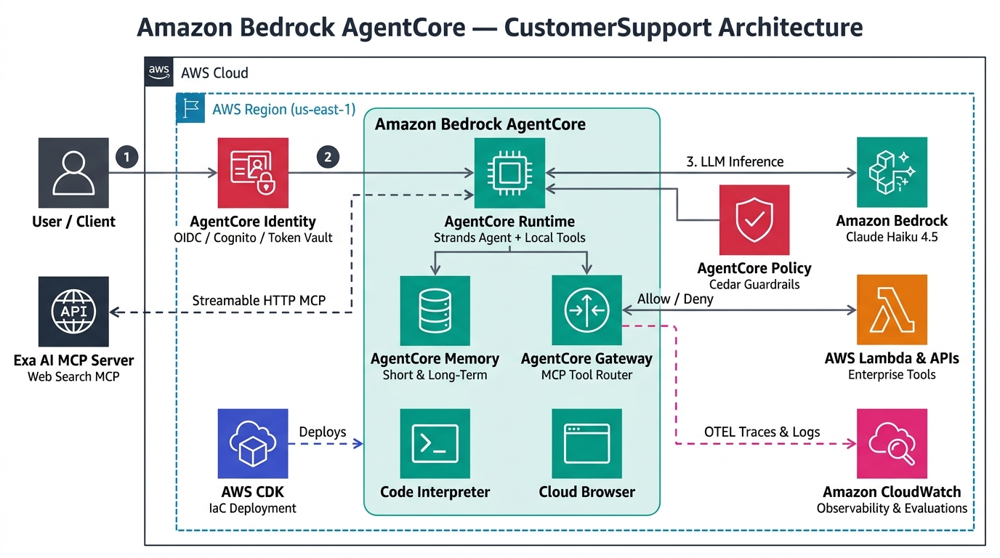
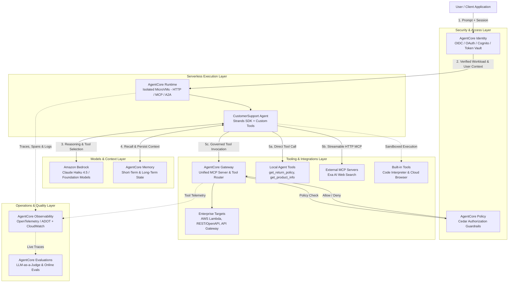
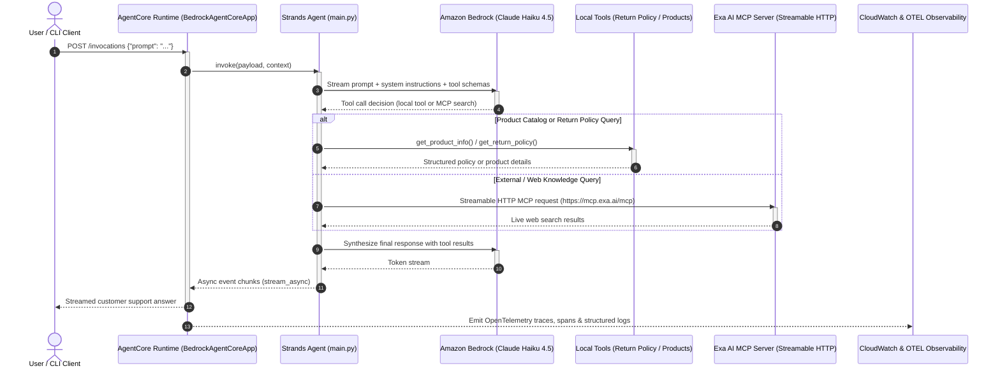

# CustomerSupport — Amazon Bedrock AgentCore Workshop Project

An end-to-end AI **Customer Support Agent** built with the **Strands Agents SDK**, **Model Context Protocol (MCP)**, and **Amazon Bedrock AgentCore**, deployed via **AWS CDK** and the **AgentCore CLI**.

> **Official Workshop Reference:** This project follows the hands-on architecture and concepts from the AWS Workshop Studio guide: **[Getting Started with Amazon Bedrock AgentCore](https://catalog.workshops.aws/agentcore-getting-started/en-US)**.

---

## Table of Contents

- [What is Amazon Bedrock AgentCore?](#what-is-amazon-bedrock-agentcore)
- [AWS Architecture Icon Diagram](#aws-architecture-icon-diagram)
- [Interactive AgentCore Architecture Diagram](#interactive-agentcore-architecture-diagram)
- [Core Components of Amazon Bedrock AgentCore](#core-components-of-amazon-bedrock-agentcore)
- [Dynamic Request Flow (CustomerSupport Agent)](#dynamic-request-flow-customersupport-agent)
- [About This Project](#about-this-project)
- [Project Structure](#project-structure)
- [Getting Started](#getting-started)
- [AgentCore CLI Reference](#agentcore-cli-reference)
- [Workshop & Documentation Links](#workshop--documentation-links)

---

## What is Amazon Bedrock AgentCore?

**Amazon Bedrock AgentCore** is a modular, fully managed AWS platform designed to take AI agents from prototype to secure, enterprise-scale production. It is:

- **Framework-Agnostic:** Works with Strands Agents, LangGraph, LangChain, CrewAI, LlamaIndex, Google ADK, OpenAI Agents SDK, AutoGen, or custom Python/TypeScript loops.
- **Model-Agnostic:** Supports foundation models in Amazon Bedrock (such as Anthropic Claude, Amazon Nova, Meta Llama) as well as external model providers.
- **Modular by Design:** Adopt only the capabilities you need—Runtime, Memory, Gateway, Identity, Policy, Observability, Evaluations, and Built-in Tools—each independently configurable.

---

## AWS Architecture Icon Diagram



---

## Interactive AgentCore Architecture Diagram

The interactive Mermaid diagram below illustrates how **Amazon Bedrock AgentCore** components interact from user invocation through runtime execution, tool routing, governance, memory, and observability.



---

## Core Components of Amazon Bedrock AgentCore

| Component | Category | Role & Key Capabilities |
| :--- | :--- | :--- |
| **AgentCore Runtime** | Execution | Serverless execution environment built specifically for agents. Runs each session in an isolated microVM with fast cold starts, extended execution support, streaming responses, and native support for **HTTP**, **MCP**, and **A2A** protocols via **CodeZip** or **ARM64 Container** builds. |
| **AgentCore Memory** | Context & State | Fully managed memory layer handling both **short-term memory** (multi-turn conversation history) and **long-term memory** (extracted user preferences, facts, and cross-session summaries) without managing vector stores or databases manually. |
| **AgentCore Gateway** | Tool Integration | Centralized MCP gateway that exposes AWS Lambda functions, OpenAPI/REST APIs, Smithy services, API Gateway endpoints, and external MCP servers as standardized, discoverable tools for agents. |
| **AgentCore Identity** | Security & Auth | Provisions dedicated agent workload identities and integrates with OIDC/OAuth identity providers (Amazon Cognito, Okta, Microsoft Entra ID). Includes a **Token Vault** for secure outbound API keys and OAuth tokens on behalf of users. |
| **AgentCore Policy** | Governance | Deterministic authorization guardrails authored in natural language or **Cedar** policy language. Intercepts tool invocations at the Gateway to enforce fine-grained allow/deny boundaries outside of agent code. |
| **AgentCore Observability** | Monitoring | Native telemetry powered by **AWS Distro for OpenTelemetry (ADOT)** and **Amazon CloudWatch**. Captures end-to-end distributed traces, prompts, tool calls, latency, token usage, and structured logs for debugging and auditing. |
| **AgentCore Evaluations** | Quality | Automated quality testing using **LLM-as-a-Judge** and code-based evaluators. Supports both offline CI/CD benchmark suites and continuous **online evaluations** on live production traffic. |
| **Code Interpreter** | Built-in Tool | Managed, isolated sandbox where agents can dynamically write and execute Python, JavaScript, or TypeScript code for data analysis, calculations, and file processing. |
| **Browser** | Built-in Tool | Managed cloud web browser allowing agents to securely navigate websites, interact with web UIs, fill forms, and extract live web content in an isolated environment. |
| **AgentCore Harness** | Managed Loop | Config-driven managed agent loop (model, tools, skills, and memory declared in config) for teams that want a production agent without maintaining custom orchestration code. |

---

## Dynamic Request Flow (CustomerSupport Agent)

The sequence diagram below traces how an incoming customer query flows dynamically through this project's `CustomerSupport` runtime, Amazon Bedrock model, local tools, external MCP web search, and observability pipeline.



---

## About This Project

This repository implements the **CustomerSupport** e-commerce assistant deployed on **Amazon Bedrock AgentCore Runtime**:

- **Agent Framework:** [Strands Agents SDK](https://github.com/strands-agents/sdk-python) (`strands-agents`) wrapped in `BedrockAgentCoreApp` (`bedrock-agentcore`).
- **Foundation Model:** Anthropic **Claude Haiku 4.5** (`us.anthropic.claude-haiku-4-5-20251001-v1:0`) via cross-region inference in Amazon Bedrock (`app/CustomerSupport/model/load.py`).
- **Custom Python Tools (`app/CustomerSupport/main.py`):**
  - `get_return_policy(product_category)` — Looks up return windows, conditions, and refund rules for `electronics`, `accessories`, and `audio`.
  - `get_product_info(query)` — Searches the product catalog (`PROD-001` through `PROD-005`) by ID, name, category, or keyword.
- **External MCP Tool (`app/CustomerSupport/mcp_client/client.py`):**
  - Connects via Streamable HTTP to **Exa AI MCP** (`https://mcp.exa.ai/mcp`) for live web search context.
- **Observability:** Instrumented with `aws-opentelemetry-distro` for CloudWatch traces and logs.
- **Infrastructure as Code:** Managed with **AWS CDK** (`@aws/agentcore-cdk`) in `agentcore/cdk/` using `CodeZip` packaging on `PYTHON_3_13` (`HTTP` protocol, `us-east-1`).

---

## Project Structure

```text
CustomerSupport/
├── README.md                              # Project documentation & AgentCore guide
├── AGENTS.md                              # AI coding assistant instructions
├── docs/
│   └── images/
│       └── agentcore-aws-architecture.jpg # AWS icon architecture diagram
├── agentcore/
│   ├── agentcore.json                     # Declarative AgentCore project spec
│   ├── aws-targets.json                   # AWS deployment targets (account & region)
│   ├── .cli/
│   │   └── deployed-state.json            # Deployed runtime ID, ARN, and stack state
│   ├── .env.local                         # Local secrets (gitignored)
│   ├── .llm-context/                      # TypeScript schema references
│   └── cdk/                               # AWS CDK stack (@aws/agentcore-cdk)
│       ├── bin/cdk.ts                     # CDK app entrypoint
│       ├── lib/cdk-stack.ts               # AgentCoreStack definition
│       └── package.json                   # CDK dependencies
└── app/
    └── CustomerSupport/
        ├── main.py                        # AgentCore entrypoint, Strands agent & @tool definitions
        ├── model/
        │   ├── load.py                    # BedrockModel (Claude Haiku 4.5) loader
        │   └── mantle_compat.py           # Bedrock Mantle compatibility helper
        ├── mcp_client/
        │   └── client.py                  # Streamable HTTP MCP client (Exa AI)
        ├── skills/
        │   └── fetcher.py                 # S3 / Git dynamic skill fetcher
        ├── pyproject.toml                 # Python dependencies & project metadata
        └── uv.lock                        # Locked dependency tree
```

---

## Getting Started

### Prerequisites

- **AWS Account & Credentials** configured (`aws configure` or `aws login`) with Amazon Bedrock model access enabled for Claude Haiku 4.5 in `us-east-1`
- **Node.js** 20.x or later
- **Python 3.10+** (Python 3.13 recommended for runtime parity) and **[uv](https://docs.astral.sh/uv/getting-started/installation/)**
- **AgentCore CLI** installed (`npm install -g @aws/agentcore-cli` or per workshop instructions)

### 1. Run Locally (Hot-Reload Dev Server)

Start the local AgentCore development server on `0.0.0.0:8080`:

```bash
agentcore dev
```

In a second terminal, invoke the local agent:

```bash
agentcore invoke --dev "What is the return policy for electronics?"
agentcore invoke --dev "Tell me about PROD-002"
```

### 2. Deploy to Amazon Bedrock AgentCore

Synthesize and deploy the CDK stack and `CodeZip` runtime bundle to AWS:

```bash
agentcore deploy
```

### 3. Invoke & Monitor the Deployed Agent

```bash
# Check deployed runtime status
agentcore status

# Invoke the deployed AgentCore Runtime
agentcore invoke "Can you find wireless headphones and tell me their return policy?"

# Inspect runtime logs and OpenTelemetry traces
agentcore logs
agentcore traces
```

---

## AgentCore CLI Reference

| Command | Description |
| :--- | :--- |
| `agentcore create` | Scaffold a new AgentCore project |
| `agentcore add` | Add resources (`agent`, `memory`, `credential`, `gateway`, `evaluator`, `policy`) |
| `agentcore remove` | Remove resources from `agentcore.json` |
| `agentcore dev` | Run the agent locally with hot-reload |
| `agentcore deploy` | Deploy infrastructure and agent code via AWS CDK |
| `agentcore status` | Display deployed runtime ARNs and stack status |
| `agentcore invoke` | Invoke a local (`--dev`) or deployed agent |
| `agentcore logs` | Stream CloudWatch logs for the agent |
| `agentcore traces` | Inspect OpenTelemetry execution traces |
| `agentcore eval` | Run automated evaluations against the agent |
| `agentcore validate` | Validate `agentcore.json` and target configuration |

---

## Workshop & Documentation Links

- **Hands-On Workshop:** [Getting Started with Amazon Bedrock AgentCore Workshop](https://catalog.workshops.aws/agentcore-getting-started/en-US)
- **AWS Product Page:** [Amazon Bedrock AgentCore](https://aws.amazon.com/bedrock/agentcore/)
- **Developer Guide:** [Amazon Bedrock AgentCore Documentation](https://docs.aws.amazon.com/bedrock-agentcore/latest/devguide/what-is-bedrock-agentcore.html)
- **CLI & Constructs:** [AgentCore CLI](https://github.com/aws/agentcore-cli) | [AgentCore L3 CDK Constructs](https://github.com/aws/agentcore-l3-cdk-constructs)
- **Agent Framework:** [Strands Agents SDK](https://github.com/strands-agents/sdk-python)
